# ⚡ Finetune Studio

**A web app for working with local language models on your own documents: search them, fine-tune on them, test the result.**

You upload your files once. From there you can build a **Smart Brain** (search plus a model that answers
from your files and cites them), or train a **LoRA adapter** that changes how a model answers (tone, format,
a fixed system prompt, some facts). There is also a chat page, test and benchmark pages, and export to GGUF.
It runs on your own machine in the browser.

This is a hobby project. I built it because I like tinkering with local models, and I did my best to make it
solid: it has a large test suite, CI, and every number below comes from a real measured run. It is still a
beta from one person, so expect rough edges. Use it if it is useful to you.

[](https://www.python.org/downloads/)
[](LICENSE)
[](#installation)
[](#how-it-works)
[](https://genortg.github.io/finetune-studio/)

---

| Files & Knowledge — every file parsed once | Smart Brain — answers from your files, with sources |
|---|---|
| 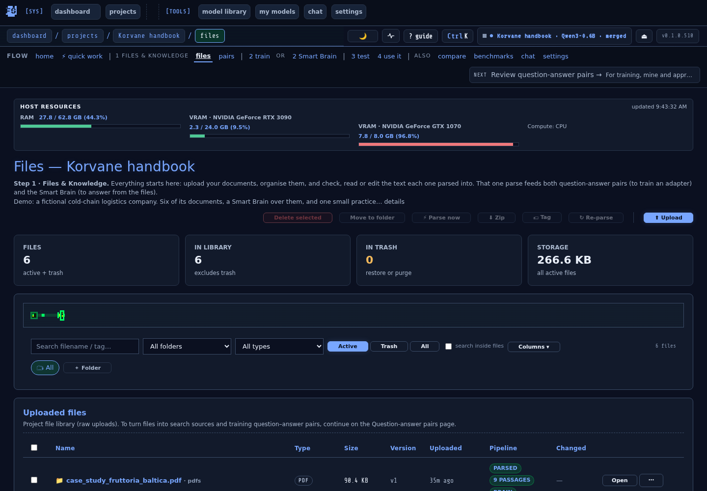 | 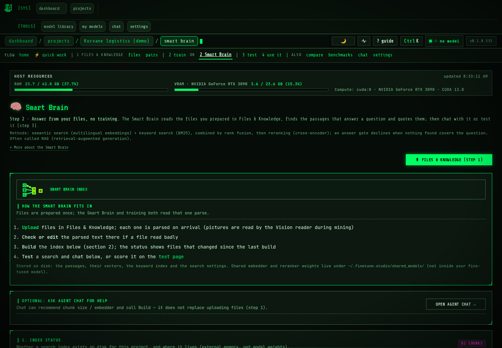 |
| **Pairs — mined, checked, reviewed** | **Training — a LoRA adapter (merged checkpoint optional)** |
| 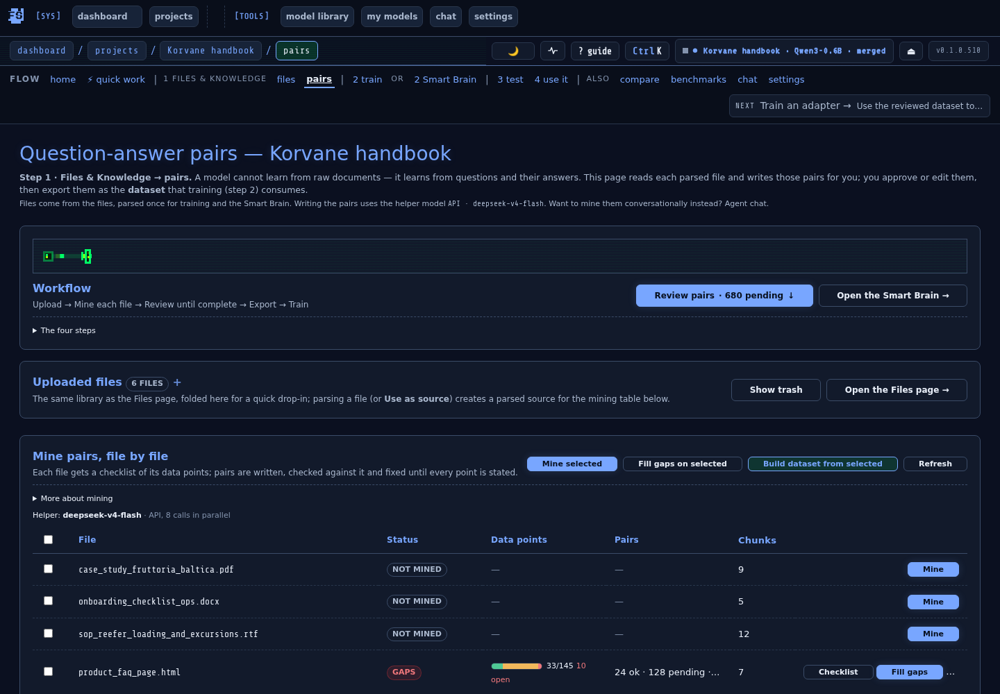 | 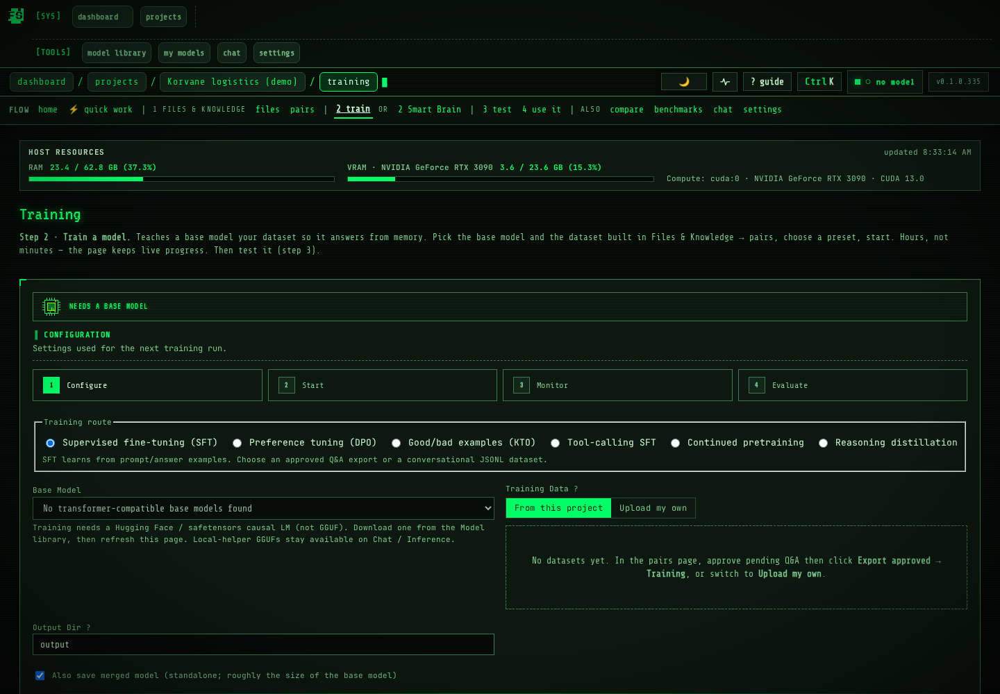 |

<sub>Screenshots: a fresh demo project built from six files of the fictional company corpus in `tests/corpus/korvane`.</sub>

## Quickstart

```bash
git clone https://github.com/GenorTG/finetune-studio.git
cd finetune-studio
./install.sh                       # detects the GPU and installs the matching torch / llama.cpp build
source .venv/bin/activate
fts webui
```

Open http://localhost:7860. The first visit offers a short onboarding tour. By default only this computer can open it; to use it from other devices, set a password
(the installer asks, or **Settings -> Access & network**, or `fts auth set-password`): see
[docs/INSTALL.md](docs/INSTALL.md#5-access-who-can-open-the-web-ui). Prerequisites and Windows/macOS notes: [docs/INSTALL.md](docs/INSTALL.md).

---

## Table of contents

- [Quickstart](#quickstart)
- [Why I built this](#why-i-built-this)
- [Who it's for](#who-its-for)
- [The four use cases](#the-four-use-cases)
- [How much does fine-tuning actually teach? (measured)](#how-much-does-fine-tuning-actually-teach-measured)
- [What's in the beta](#whats-in-the-beta)
- [Why not just do it by hand?](#why-not-just-do-it-by-hand)
- [Walkthrough — the pages](#walkthrough--the-pages)
- [Installation](#installation)
- [How it works](#how-it-works)
- [Tech stack](#tech-stack)
- [Documentation](#documentation)
- [Contributing](#contributing)
- [License & attributions](#license--attributions)

> **New here?** The fastest path from zero to a trained model is the
> step-by-step [**Tutorial**](docs/TUTORIAL.md) — or open **⚡ Quick work**
> inside a project and chain files → pairs → train → test in one page.
> Common first-run pitfalls are covered in both.

---

## Why I built this

Training a model on your own documents means a lot of separate steps: installing the right CUDA build,
downloading weights, turning PDFs into clean text, writing question/answer pairs, a training loop, watching
VRAM, testing the result, exporting it. Each step has good tools, but I kept ending up with five terminals
and a page of notes on what to run next.

So I put the steps I use into one app with one project at the centre. It is not trying to compete with
cloud training platforms. It is the workshop I wanted for my own experiments, cleaned up so other people
can use it too.

---

## Who it's for

- People who want to ask questions about their own documents with a local model, without sending them
  anywhere.
- Hobbyists who want to try LoRA fine-tuning on a single consumer GPU (I use an RTX 3090) without writing
  the training code.
- Anyone curious about what fine-tuning really does to a model: the test pages and the measurements below
  show it, including where it falls short.

You don't need every page. Most people start with one thing (the Smart Brain, a fine-tune, or just chat).

---

## The four use cases

You don't have to use every feature. Pick what you need.

### Use case 1 — A Smart Brain over private documents (no training)

> *"I have a pile of PDFs and I want to ask questions about them in plain
> English — without uploading anything to the cloud."*

Every file goes one route first — **Files & Knowledge**: uploaded, parsed once
(pictures and charts read by an optional Vision reader), checkable and editable.
The **Smart Brain** reads that same parse and answers questions with sources.
Its search combines semantic search (multilingual embeddings) and keyword
search (BM25) by rank fusion, then reranks with a cross-encoder; an answer gate
declines when nothing found covers the question (often called RAG). The studio
handles:

- File ingestion for common text, code, data, office, email, and image
  formats; OCR uses Tesseract and may fetch language data on first use.
- Configurable chunking strategy
- Embedder model selection (any SentenceTransformer-compatible model)
- Live build progress via Server-Sent Events
- An index status that says *up to date* or *rebuild needed* (files edited,
  added or removed since the build), and a documents panel with chunk previews
- Optional **fact cards**: reviewed (approved) Q&A pairs indexed next to the
  passages they came from
- **Standalone export**: one download turns the corpus into a self-installing
  package (its own venv) that serves search over **MCP**
  (Claude Desktop / OpenClaw / Cursor) *and* a plain **HTTP API** —
  `bash setup.sh` does the rest: install, port choice, start-now, optional
  persistent service (`--uninstall` removes it), and a copy-paste MCP entry
  with real absolute paths. Keyword
  search works offline out of the box; point it at any OpenAI-compatible
  embeddings endpoint for semantic search — or tick "Include models" and the
  embedding model + reranker ship **inside** the package: full offline
  semantic search with no external service at all (~2.3 GB archive)

### Use case 2 — Train an adapter (LoRA) on your pairs

> *"I want to teach a small open model how my company talks, how to answer
> support questions, how to follow our style guide."*

An adapter teaches **how to answer** much better than it teaches a set of documents. On the fictional
test company (1,130 facts, Qwen3.5-9B) a fine-tune alone answered 10–28 % of reworded quiz questions (47 % once
the training set held reworded questions too); with the Smart Brain it was 94 of 102. Details: [How much does fine-tuning actually teach?](#how-much-does-fine-tuning-actually-teach-measured)
Put the facts in the Smart Brain and train the adapter on how you want answers phrased.

The **Training** workflow lets you point the studio at a JSONL of
prompt/completion pairs (or your own dataset), pick a base model, and run a
supervised fine-tune (SFT) with LoRA or QLoRA. The studio handles:

- Adapter merging, model export, VRAM profile checkpoints
- Real-time loss + step counter, gradient norm, learning rate
- Configurable LoRA rank, target modules, batch size
- A merge step that produces a self-contained checkpoint you can load in
  chat
- Per past-run Actions (⭐ Set production, ▶ Open in inference, ⬇ Export) so
  you can promote, try or package any of your previous runs

### Use case 3 — Benchmark before you ship

> *"I trained two variants. Which one is actually better?"*

The **Benchmarks** workflow runs offline evaluation suites (built-in
MMLU-/GSM8K-/HellaSwag-style smoke fixtures, plus project-local suites) and
gives you a **comparison table**. Two tabs: **Recent scores** (rolling
history) and **Compare two runs** (pick any two trained exports, get the
per-suite Δ table).

These are local smoke suites styled after well-known benchmarks — not the
full HuggingFace dataset downloads — so they stay offline and fast.

### Use case 4 — Just chat with local models

> *"I want to run an open model locally, with my own chat history and image
> support."*

The **Chat** page is a simple chat client. Pick a safetensors or GGUF model on
disk, load it (with auto-unload on idle to free VRAM), and chat. Image
input for multimodal models. Per-session temperature / top-p / system
prompt. Conversation persists across reloads.

---

## How much does fine-tuning actually teach? (measured)

I wanted a straight answer to "if I fine-tune a model on my documents, does it know them?", so I built a
fictional company (Korvane, a cold-chain logistics firm: 80 files in 13 formats, 1,130 facts with a known
answer key, in `tests/corpus/korvane/`) and measured it. The quiz asks 102 questions **reworded** from the
training pairs, so a model cannot pass by matching the training text word for word, plus 20 questions the
documents do not answer. An AI judge scores each answer, checked against 50 hand-labelled cases. Base model:
Qwen3.5-9B, QLoRA on one RTX 3090.

| Setup | Quiz: correct / partly / wrong (of 102) | Says "not in the documents" when it should (of 20) |
|---|---|---|
| Base model, no training, no Smart Brain | 3 / 4 / 95 | 6 |
| Fine-tuned, 6 epochs on ~2,450 reviewed pairs | 19–28 / 23 / 51–60 | **0** |
| Fine-tuned + 240 "I don't know" training rows | 15 of 102 correct (simple matcher) | 2 |
| Fine-tuned, 3 epochs, each pair + 3 reworded questions | 48 of 102 correct (simple matcher; 15 without rewording) | **0** |
| Base model + Smart Brain | 76–97 / 2–5 / 3–21 | **20** |
| Fine-tuned + Smart Brain | 82–94 / 3–5 / 5–15 | 0–2 |

Ranges cover several runs with different settings (top-k, reader model, quantisation); every run is
written up in [`tests/corpus/korvane/RESULTS.md`](tests/corpus/korvane/RESULTS.md).

What I take from it:

- **Fine-tuning learns some facts, not all of them.** About a quarter of the reworded questions come back
  right and another fifth half-right (right entity, wrong number). Six epochs beat three; quantising the
  merged model to GGUF q4 cost up to 9 points. Training each pair under 3 extra reworded questions
  (one cheap API call per pair) took the simple-matcher score from 15 to 48 of 102 in one run.
- **A fine-tuned model stops saying "I don't know".** The base model declines questions its documents don't
  cover; after fact training it invents a confident answer for all 20. Adding 240 example declines to the
  training data only brought that to 2 of 20.
- **Fact training costs some general skill.** Asked the same seeded questions as the base model, a fact
  adapter followed instructions worse (IFEval 83 % -> 68-70 %, clearly more questions lost than gained) and
  dropped about 6 points on MMLU. Mixing in 30 % of the base model's own answers to general prompts (the
  replay option on the Training page) kept IFEval at 83 % but cut fact recall from 53 to 37 of 102, so it is
  a trade-off and off by default.
- **For facts, the Smart Brain wins clearly**: up to 97 of 102 with sources, and it declines correctly.
  So the app recommends the Smart Brain for "know my documents" and an adapter for "answer in this style".

---

## What's in the beta

The larger pieces, roughly in the order you meet them:

- **⚡ Quick work** — the entire model pipeline on one page (upload →
  pairs → dataset → train → test → pin), a live status pill per step, and
  **Run steps 2–5** to chain dataset → training → test unattended.
- **One project flow** — `1 Files & Knowledge (files · pairs) → 2 train
  or 2 Smart Brain → 3 test → 4 use it`: every file is parsed once and both
  routes read that one parse; the project home offers both as cards.
- **File browser v2** — folder chips with drag-to-move, tag pills, bulk
  actions, zip export, per-file usage chain (file → pairs → datasets →
  runs → Smart Brain), knowledge search (facts + passages, edit in place),
  thumbnails, columns picker, 7-day
  trash (select and restore).
- **Chunk-coverage fallback** — dataset export can fill chunks without an
  approved generated pair with verbatim extractive pairs. The project data
  audit reports coverage issues; this is a data-coverage check, not a
  guarantee that a model learned every fact.
- **Full-coverage test suites** — auto-suites test every dataset row
  (N rows → N questions); sampling is an explicit, labeled opt-in.
- **Project versions** — immutable manifests pinning datasets + sources +
  corpora + runs + base model, with lineage; pin from Quick work Step 6.
- **Standalone Smart Brain** — the index ships as a self-installing
  tarball (MCP + HTTP, `setup.sh`, optional bundled embedder + reranker
  for fully offline semantic search).
- **Parsed-text editor** — fix a bad parse in-app; corrections feed
  mining and the next Smart Brain build while raw bytes stay immutable.
- **Per-commit build chip + Linux in-app update** — the header pins the exact
  deployed version (`v0.1.0.N`); on Linux, Settings → Apply update pulls,
  repairs, migrates and restarts. Windows updates are manual.
- **Dark and light themes** — switch themes in the UI; responsive layout
  and theme behavior have dedicated regression checks.

---

## Why not just do it by hand?

| What you'd do manually | What Finetune Studio does |
|---|---|
| Write a Python script to download weights from HF | Browse HF Explorer in-app, click download |
| Configure transformers + accelerator + trl + peft + bitsandbytes | Pick base model + LoRA rank + batch size in a form |
| Write your own chunking + embedding loop | Click "Build" — chunking, embedding, indexing all wired |
| Open 4 terminal windows to monitor training | Watch the live progress bar in one panel |
| Hand-craft an eval script from scratch | Pick a suite, click Run, get a score table |
| Open a second tab to compare two trained runs | Pick run A + run B, click Run comparison, get the diff |
| Lose an afternoon to CUDA install issues | One `./install.sh` does it |
| Re-discover package version conflicts every 3 months | Pinned dependencies, versioned upgrades |
| Debug a model load failure from "ENOMEM" | Actionable error: how much VRAM is needed vs free, and which other GPU processes are holding it |

You can do every one of these by hand, and for a one-off that is fine. The app
is for when you repeat the loop: the steps share one project, and all your
data stays in `~/.finetune-studio/` where you can find it.

---

## Walkthrough — the pages

### Dashboard (`/`)

The home view. Host resources (RAM / VRAM bars updated live), your
projects, quick-create buttons.

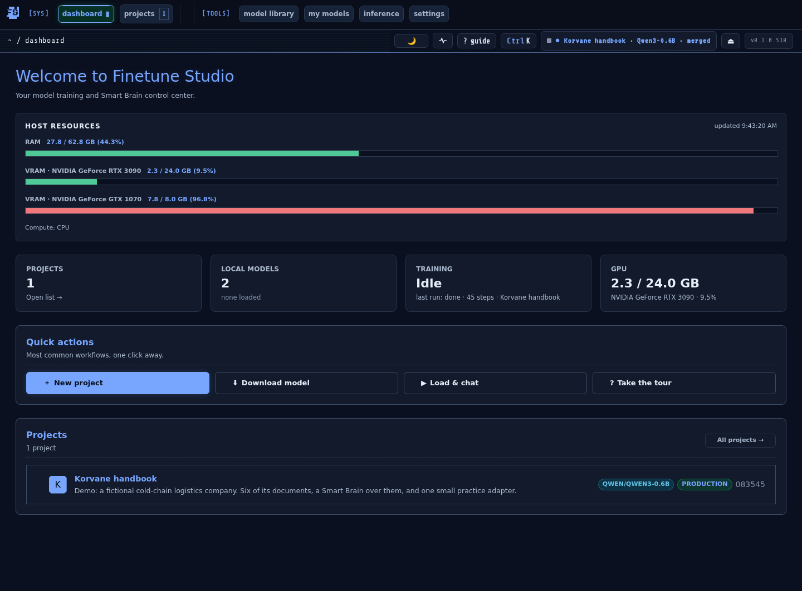

### Project home (`/projects/{pid}`)

Answers “where am I?”: a **project checklist** for the adapter path (files → dataset → train →
test → pick the adapter) with a link to the Smart Brain for answers without training, then live
counts for files, datasets, runs and models, recent training runs, latest exports, recent files
and the activity feed.

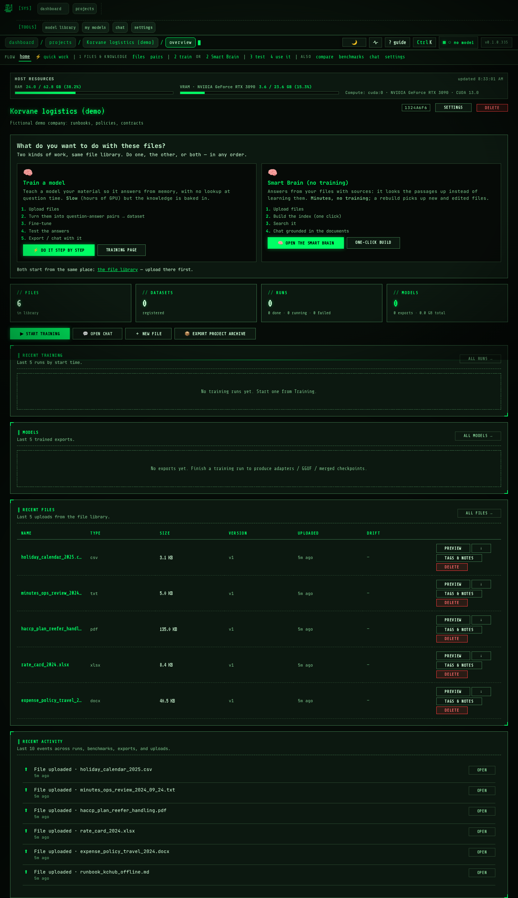

### ⚡ Quick work (`/projects/{pid}/work`)

The whole pipeline on one page: six numbered cards — **1** upload files,
**1b** build the Smart Brain (one click, live coverage pill), **2** make
question-answer pairs, **3** build the dataset, **4** train, **5** test,
**6** pin & use — each with its own button and status pill, plus
**Run steps 2–5 now** to chain dataset → training → test unattended while
progress streams below. This is the recommended path; the individual pages
are there when you want fine control.

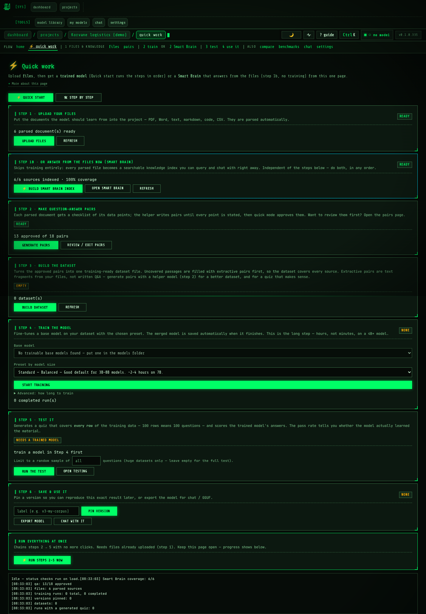

### Files & Knowledge — step 1 (`/projects/{pid}/data` and `/data-prep`)

The file browser: drag-drop upload (SHA-256 dedup, MIME auto-folders, raw
bytes immutable), renameable folder chips with drag-to-move, tag pills with
click-to-filter, bulk actions (delete / restore / move / re-parse / tag),
thumbnails, sortable + pickable columns, pagination, ⬇ zip export, a
**knowledge search** over mined facts and parsed passages (edit, approve or
reject a fact in place), ℹ️ a per-file usage chain (file → parse → pairs →
datasets → runs → Smart Brain), a built-in **parsed-text editor** (corrections
feed mining and the next Smart Brain build without touching the original), and a
7-day soft-delete trash (select and restore). Every readable upload is parsed once,
on arrival; training and the Smart Brain both read that parse.

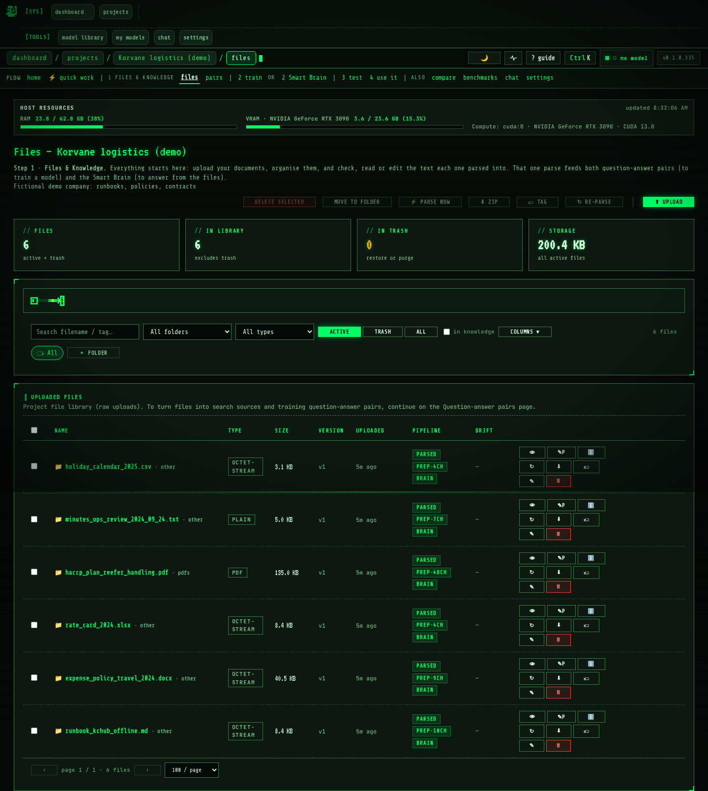

### Pairs — Files & Knowledge, training side (`/projects/{pid}/data-prep`)

Question-answer pairs, mined file by file by the helper model (a local GGUF or any
OpenAI-compatible API): each file gets a checklist of its data points, pairs are written,
checked against the text and fixed until every point is stated or excluded. You review them
with the keyboard (approve / reject with a reason / edit / add your own) beside the source
passage. **Export approved → Training** writes the dataset, and is held back until every file's
checklist is complete. A complete checklist means every fact has a reviewed pair, not that the
model will learn it (see the measurements above).

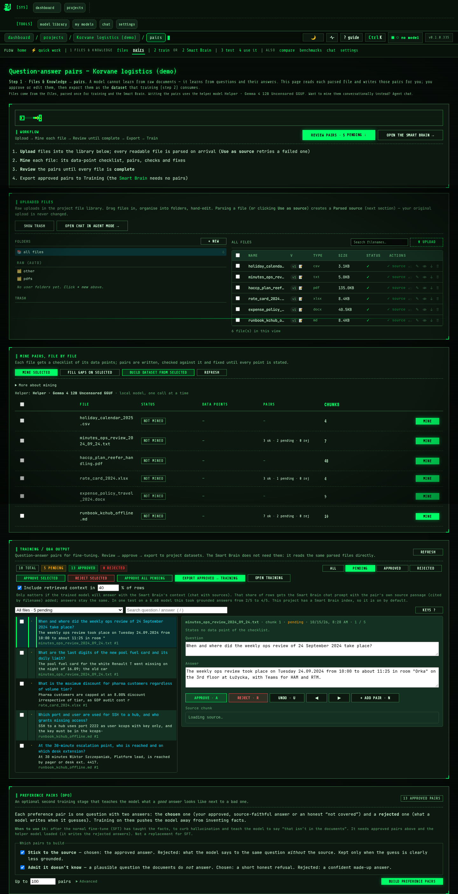

### Smart Brain — step 2 without training (`/projects/{pid}/brain`)

Build an index, search it, tune retrieval parameters, and take it with you.
Sections are numbered in workflow order: **1. Index status**, **2. Build the
index** (⚡ Quick index parses anything not parsed yet and builds, in one click), **3. Search
settings**, **4. Documents in the index**, **5. Search test**, **6. Ask the
model (grounded)**, **7. Download / export the index**, **8. Shared search
models**. The export card offers the encrypted studio bundle (`.ftsrag`) and the
**standalone Smart Brain** (`POST /api/projects/{pid}/brain/standalone`) — a
self-installing tarball with the index, a single-file Python server,
`setup.sh`, MCP config example, and a README; it speaks MCP over stdio and
REST over HTTP, and can ship the embedder + reranker inside for fully
offline semantic search. Index is persisted on disk as
`~/.finetune-studio/brain/{pid}/{chunks.parquet,vectors.npy,
bm25.json,sources/*.txt}`. The index node sprite shows document nodes
connecting to embedding vectors in real time.

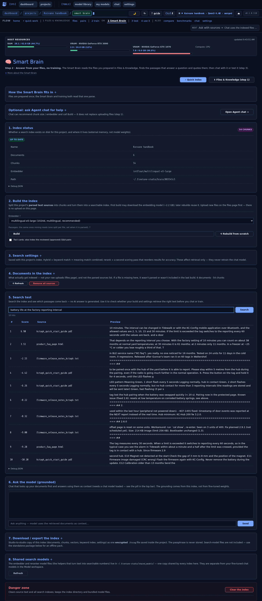

### Training — step 3 (`/projects/{pid}/training`)

Configure an adapter run, watch loss curves live. Base-model and preset
pickers recommend rank/LR/epochs from your base size and dataset size. Each
past run in the **Past runs** table carries Actions (Details, ⭐ Set production,
▶ Open in inference, ⬇ Export) so you can inspect, promote or package any
previous run from one place. The status chip says whether the run trains on
the GPU or the CPU.

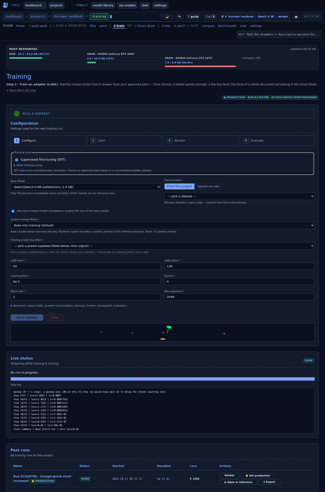

### Testing — step 4 (`/projects/{pid}/testing`)

Did it learn *your* material? A test is two separate steps. **Run** asks the
model every question (auto-generated project suites cover **every row** of the
training dataset; sampling is an explicit, labeled opt-in, or import your own
quiz) and saves exactly what it answered next to the correct answer. **Judge**
is a separate pass: an AI judge (any connected model; by default the helper)
reads each saved answer and decides pass / partial / fail with its reasoning,
and you can override any verdict by hand in the review pane. Nothing is scored
by string matching, so a right answer worded differently still passes; an
unjudged run shows "awaiting judgement", never a made-up score. Judging can
start by itself after each run if you tick that box (off by default).

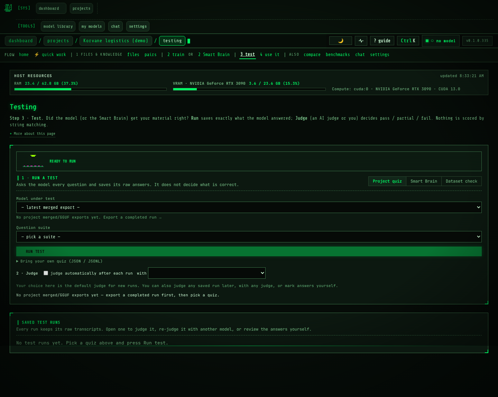

### Models — step 5 (`/projects/{pid}/models`)

Every trained export from every run, in a 7-column table (Name / Format /
Size / Source run / Created / Copy path / Actions). Click any row's name
to **expand** it and see the parent training run, the training settings
(LR, rank, batch, epochs, max seq length, merge-on-save), and a top-level
directory listing. ▶ Open in inference jumps straight to chat.

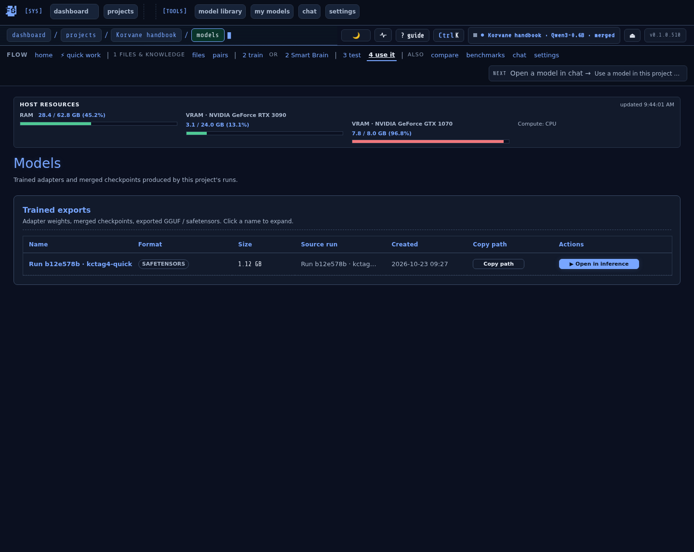

### Export (`/projects/{pid}/export`)

Pick a run, pick a format, hit RUN. Supported formats today:

- **merged** — adapter merged onto a compatible base (safetensors)
- **abliterated** — refusal-direction edit of a merged checkpoint
- **GGUF** — when llama.cpp conversion tools are installed on the host;
  otherwise the API fails with a clear install hint

The trained-exports table uses the same expand-row pattern as Models —
click a row to inspect its contents, then ▶ Open in inference.

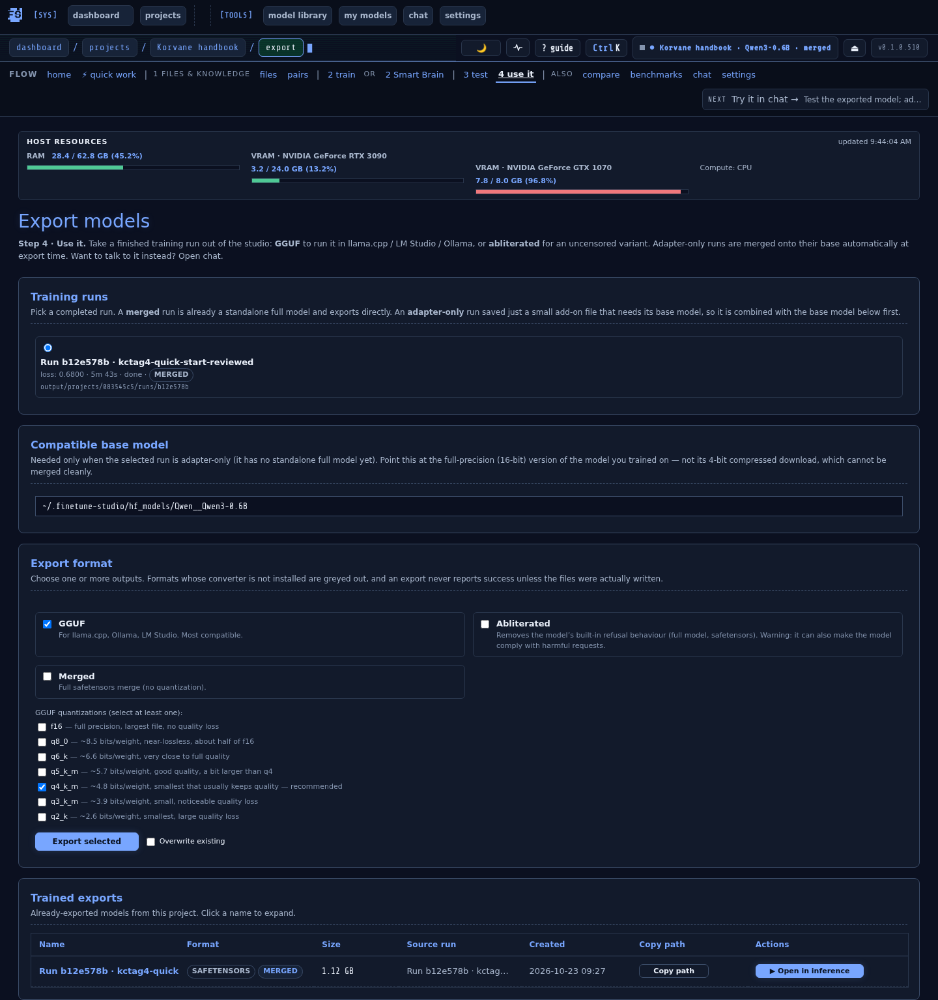

### Chat (`/projects/{pid}/chat`)

Pick a safetensors or GGUF model, load (auto-unload on idle frees VRAM),
and chat — streaming with sprite feedback, image input for multimodal
models, per-session temperature / top-p / system prompt, persistent
history, the Smart Brain for answers with sources, and Agent mode for tool-driven
dataset curation.

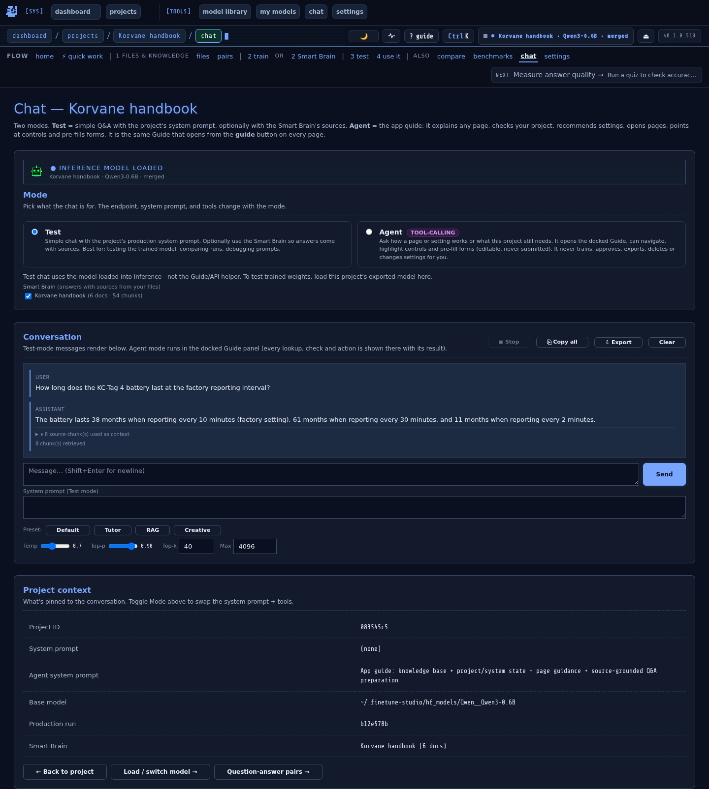

### Benchmarks (optional, per project: `/projects/{pid}/benchmarks`)

Public exams, separate from your project test: offline smoke suites
(MMLU-/GSM8K-/HellaSwag-style) plus project-local suites, real HF splits
when you allow downloads. Two tabs: **Recent scores** (live history) and
**Compare two runs** (pickers + a per-suite Δ table). The BenchBars sprite
fills in as scores arrive.

### Settings (`/settings`, per-project under `/projects/{pid}/settings`)

App settings (shown below): who may open the web UI (password, LAN /
Tailscale, API tokens), the default test judge, the helper model (local GGUF
or an API), the Vision reader, the service supervisor, which GPU (or the CPU)
to use, debug info and storage paths. On Linux it also has the in-app **Apply
update** controls; **Replay tutorial** works everywhere. Each project has its
own settings page too, with a **WebUI log tail** for debugging long jobs.

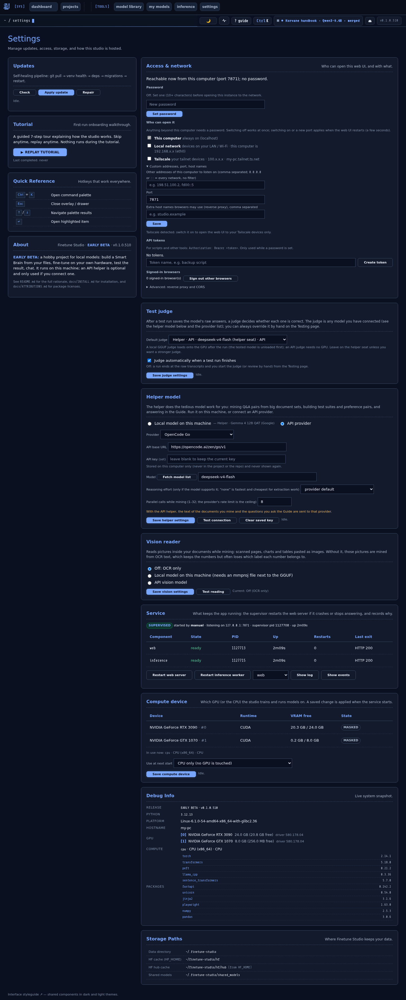

---

The session bar at the top of every page is a Tmux-style tab strip with
**[SYS]** and **[TOOLS]**. Inside a project, one flow bar shows every step —
`1 Files & Knowledge (files · pairs) → 2 train or 2 Smart Brain → 3 test →
4 use it`, plus compare, benchmarks, chat and settings. The current page is
marked.
`Ctrl+K` opens the command palette — fuzzy-search any page in any
project.

---

## Installation

See **[docs/INSTALL.md](docs/INSTALL.md)** for prerequisites and
step-by-step installation instructions. The supported Python range is
3.12–3.13; check the guide for current OS-specific paths and limitations.

---

## How it works

```
┌───────────────────── BROWSER (any modern) ─────────────────────┐
│                                                                │
│   Tmux-style session bar ─── project tabs ── status pill       │
│   ┌──────────────────────────────┐  ┌────────────────────────┐ │
│   │ FastAPI + Jinja2 templates   │  │ Live SSE for progress  │ │
│   │ Vanilla JS / CSS (no build)  │  │ Chat streaming         │ │
│   │ Playwright E2E smoke suite   │  │ Tail /api/…/logs       │ │
│   └──────────────────────────────┘  └────────────────────────┘ │
└────────────────────────────────────────────────────────────────┘
                              │  HTTP + Server-Sent Events
                              ▼
┌───────────────────── PYTHON SERVER (local) ─────────────────────┐
│                                                                │
│   FastAPI app ── projects API ── knowledge + Smart Brain       │
│               ── training runner (trl+peft)                    │
│               ── inference (transformers and/or llama.cpp)     │
│               ── benchmarks (offline smoke + local suites)     │
│                                                                │
│   Storage: SQLite for project metadata                         │
│            + ~/.cache/huggingface for model weights             │
│            + ~/.finetune-studio/brain/{pid}/  (parquet)         │
└────────────────────────────────────────────────────────────────┘
```

- **Backend:** FastAPI + Jinja2. ASGI server (Uvicorn).
- **Frontend:** Vanilla HTML + CSS + JS. No build step. Sprites are
  inline SVG with CSS keyframe animations.
- **Storage:** SQLite for project metadata and each file's parse state,
  `~/.finetune-studio/projects/{pid}/files/` for the files and their one
  parse, the Smart Brain index (parquet + vectors + BM25) under
  `~/.finetune-studio/brain/{pid}/`, HuggingFace `~/.cache/` for model weights.
- **Streaming:** Server-Sent Events for live progress on Smart Brain builds,
  training, activity, and related long-running jobs; project log tail
  for on-demand server logs.
- **Inference:** HuggingFace Transformers for safetensors / LoRA merges;
  llama.cpp (via `llama-cpp-python`) for GGUF when available.
- **Export:** merged and abliterated are first-class; GGUF needs llama.cpp
  conversion tools on the host. Missing tools return clear errors instead
  of fake success.
- **Testing:** the Playwright route suite `tests/e2e_ui_qa.py` is non-mutating;
  the Guide flow `tests/e2e_guide_sandbox.py` runs against its own fake helper
  and temporary database. Both have a real-browser path. Other live E2E
  drivers may mutate data or use a GPU; inspect the selected driver and require
  explicit `FTS_ALLOW_LIVE_E2E=1` before pointing it at a running instance.
- **Updates:** self-healing pipeline — `./update.sh` or Settings → Apply
  update (pull → venv repair → dep sync → migrations → restart), with
  startup reconciliation of interrupted runs.

---

## Tech stack

Python 3.12–3.13 — `fastapi` `uvicorn` `jinja2` `sqlite3` (stdlib) `pydantic`
ML — `torch` `transformers` `trl` `peft` `bitsandbytes`
Smart Brain — `sentence-transformers` (embeddings + cross-encoder reranking), BM25, rank fusion · `llama-cpp-python`
Web — vanilla HTML/CSS/JS, system UI typography, locally vendored font assets
Tests — `playwright` `pytest`

Full list with versions and licenses → **[docs/ATTRIBUTIONS.md](docs/ATTRIBUTIONS.md)**

---

## Documentation

- **[docs/TUTORIAL.md](docs/TUTORIAL.md)** — end-to-end first-model tutorial (users start here)
- **[docs/DESIGN.md](docs/DESIGN.md)** — layout, rules and checks for contributors
- **[docs/INSTALL.md](docs/INSTALL.md)** — install on Linux / macOS / Windows, prerequisites, troubleshooting
- **[docs/DEPENDENCIES.md](docs/DEPENDENCIES.md)** — every dependency mapped to its consumers
- **[docs/DEPLOYMENT.md](docs/DEPLOYMENT.md)** — service, update pipeline, generic ops notes
- **[docs/ATTRIBUTIONS.md](docs/ATTRIBUTIONS.md)** — every package, version, license
- **[⚡ Presentation page](https://genortg.github.io/finetune-studio/)** — the gallery version of this README
- **/settings** — live debug info on your running instance (version, GPU, packages, paths) **+ WebUI log tail card**
- **Settings → Replay** — replay the built-in onboarding tour

---

## Contributing

PRs welcome. Open an issue first if the change is large — this codebase
prefers clear minimal patches over sweeping refactors. New features should
add a focused unit/regression test under `tests/`, and browser-visible
changes should extend the Playwright smoke suite when practical.

---

## License & attributions

**[PolyForm Noncommercial License 1.0.0](https://polyformproject.org/licenses/noncommercial/1.0.0)** plus Finetune Studio Additional Terms. See `LICENSE`. Personal, scientific, and non-commercial use is free. Commercial use and commercial model training require a separate paid license — see `LICENSE` (Additional Terms) and `docs/LEGAL.md`.

> Note: this is *source-available* software, not an OSI-approved open-source license, because it restricts commercial use.

Every dependency used is open source — see
**[docs/ATTRIBUTIONS.md](docs/ATTRIBUTIONS.md)** for the full list,
versions, and licenses. Thank you to the maintainers of PyTorch,
Transformers, PEFT, llama.cpp, PortableRAG, SentenceTransformers,
FastAPI, Jinja, and the rest of the open-source ecosystem this is built
on.

---

<div align="center">

Made by one person who likes tinkering with local models. Self-hosted by default; optional downloads
and integrations may use external services.

</div>
