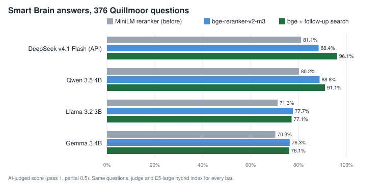
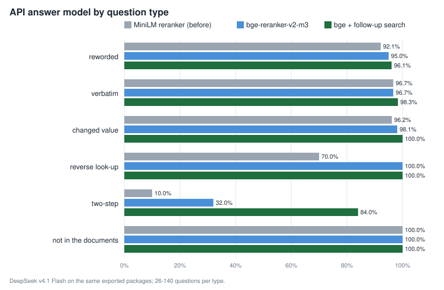
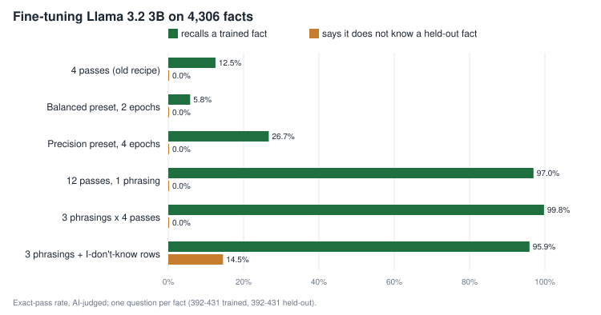

# Quillmoor benchmark — October 2026

*Measured on one machine (RTX 3090 24 GB, 6 CPU cores, 62 GB RAM, Linux) against the live app on `dev`
(v0.2.0 + unreleased fixes; final benchmark service commit `9de8e610` / PR #42, 2026-10-29). Earlier runs made before
PRs #39–#42 are called out where their results appear. Every number comes from a script in `tests/corpus/quillmoor/bench/` that
calls the live app's HTTP routes and job APIs, then starts the exported package's own server. It verifies these
product paths and outputs, but is not a browser/UI walkthrough. Raw results:
`tests/corpus/quillmoor/RESULTS.md`.*

## 1. Why a generated corpus

To claim "it reads your files and answers correctly" you need files whose every fact you know. Quillmoor is a
generated company (tidal stations, water works, a fleet, contracts, policies, software services) written into 42
generated filename extensions across 29 document archetypes, with an answer key for every value and a question set that includes re-worded questions, values that
changed later, two-step questions, look-up-by-value questions and questions the files cannot answer. The generator and
the corpus description are in [`tests/corpus/quillmoor/`](../../tests/corpus/quillmoor/README.md). Nothing in it
exists, so a model can only answer from what the app gave it.

| Tier | Files | Size | Facts | Questions |
|---|---|---|---|---|
| S | 415 | 32.9 MB | 4,306 | 757 (431 re-worded, 150 verbatim, 26 changed-value, 50 two-step, 40 by-value, 60 unanswerable) |
| M | 1,927 | 146 MB | 25,112 | 1,257 |
| L | 10,407 | (see §3.3) | 157,614 | 1,978 |

## 2. Method

- **Ground truth is mechanical, grading is not.** Parser output is checked for normalized substring presence of each
  generated marker (not an exact field/token match); retrieval uses generated gold passage IDs. Whether an *answer* is right is decided by
  the app's AI judge (`testing/judge.py`, API model `deepseek-v4.1-flash`), which receives the answer key, the
  accepted spellings and, for changed values, the outdated value marked wrong. Pass = 1, partial = ½.
- **Retrieval hit@k**: the question counts as found at rank *r* when the passage at rank *r* comes from a file that
  states the answer and contains its exact value; a two-step question needs both hops within the top *k*.
- **Answer-model set**: each model is submitted the same deterministic 376-question set: 140 paraphrases, 60 verbatim
  prompts, and every superseded, multi-hop, reverse, and unanswerable question. Failures remain uncovered in the table.
  Scores use judged answers only;
  answer coverage and judge coverage are reported against all 376 expected question IDs.
- **Retrieval matrix**: Tier S crosses seven embedding models with three reranker settings (off, MiniLM, BGE) in
  meaning-only and hybrid modes, plus one embedder-independent word-only run per reranker: 45 configurations.
  Tiers M and L use the E5-large embedder with off/on MiniLM reranking in word-only and hybrid modes to measure scale.
- **Through the product APIs**: uploads use the same HTTP route called by Files, indexes are built by the Smart Brain
  job, search and answers go through **exported standalone packages** started from their own `server.py`, and training
  uses the same start route as Training (SFT LoRA, merged and exported to GGUF in the same job). Answer models are
  served by the llama.cpp build the app installs. Browser controls and visual feedback are outside this benchmark.
- **Training validity**: a result counts only if the run is terminally successful, final loss is finite and positive,
  and a nonempty GGUF artifact exists. Failed, divergent, or partial exports remain visible as failures, not scores.
- **Shared-host measurement**: all runs used one RTX 3090 host, and benchmark GPU jobs were serialized by a lock.
  Other host activity was not stopped or controlled, so latency figures describe this machine under its observed load;
  they are not isolated-hardware capacity guarantees.

## 3. Files & Knowledge: do the generated formats parse correctly?

### 3.1 Generated marker coverage by type

Upload → the app's parse → the parsed text read back → each normalized marker checked for substring presence.

| Type | S files | S markers | S substring hits | M files | M markers | M substring hits |
|---|---|---|---|---|---|---|
| `.txt` `.md` `.markdown` `.log` | 52 | 285 | 100 % | 251 | 1,680 | 100 % |
| `.py` `.js` `.ts` `.tsx` `.jsx` `.css` | 42 | 83 | 100 % | 144 | 291 | 100 % |
| `.ini` `.cfg` `.conf` | 15 | 37 | 100 % | 45 | 111 | 100 % |
| `.csv` `.tsv` | 11 | 618 | 100 % | 46 | 4,090 | 100 % |
| `.json` `.jsonl` `.xml` `.yaml` `.yml` | 29 | 1,071 | 100 % | 115 | 6,103 | 100 % |
| `.html` `.htm` | 31 | 186 | 100 % | 154 | 1,058 | 100 % |
| `.pdf` (text) | 15 | 82 | 100 % | 77 | 467 | 100 % |
| `.docx` `.doc` `.odt` `.rtf` `.epub` | 76 | 509 | 100 % | 389 | 2,765 | 100 % |
| `.xlsx` `.xls` `.ods` | 25 | 1,048 | 100 % | 113 | 6,192 | 100 % |
| `.pptx` `.odp` | 30 | 306 | 100 % | 155 | 1,888 | 100 % |
| `.eml` | 15 | 96 | 100 % | 76 | 466 | 100 % |
| `.pdf` (scanned, OCR) | 12 | 28 | 100 % | 74 | 134 | 99.3 % |
| `.png` `.jpg` `.jpeg` `.gif` `.bmp` `.tif` `.tiff` `.webp` (OCR) | 62 | 144 | 94.4 % | 288 | 712 | 95.1 % |
| **All** | **415** | **4,493** | **99.82 %** | **1,927** | **25,957** | **99.86 %** |

No file failed to parse in S, M, or L. OCR found 164/172 marked values in S and 810/846 in M. The eight S misses are
superscripts in `m³/h`; M has 35 such rating misses and one missed call sign. A follow-up identifier-boundary re-read
(the same parsed text; hyphens count as identifier characters) yielded S 4,485/4,493 (99.82%), M 25,921/25,957
(99.86%), and L 161,868/162,050 (99.89%), identical to substring totals. The test is still not field-aware. The
per-extension table covers the 42 generated extensions. This is representative generated-fixture evidence, not support
coverage for every real producer or layout; the parser registry's `.msg` entry currently does not parse Outlook's
OLE-based MSG container (Microsoft [MS-OXMSG](https://learn.microsoft.com/en-us/openspecs/exchange_server_protocols/ms-oxmsg)).

### 3.2 Speed, and the bug the benchmark found

| Tier | Upload | Parse finished after upload | Files/s overall |
|---|---|---|---|
| S, before the fix | 14 s | 317 s | 1.3 |
| S, after the fix | 26 s | 30 s | 7.4 |
| M, after the fix | 137 s | 62 s | 9.7 |

The first S run took 317 s and lost 48 values: 14 pictures and scans came back as "(no text found)". The cause was
OpenMP: each of the ~12 files parsed in parallel started a Tesseract with one thread per core, and the threads
starved each other — one small photo took **137 s** to OCR instead of **1.7 s**, close to the 180 s limit after which
a picture is silently left empty. Tesseract now runs single-threaded (parallelism comes from parsing several files at
once): fix #39, with a regression test.

### 3.3 The large tier

10,407 files (773 MB, 157,614 facts) went through the same upload call in batches of 50: upload 12.7 min, every file
parsed 3.4 min later, **0 parse failures**, **157,397 of 157,397 non-picture values** found and 4,471 of 4,653 on
pictures and scans (96.1 %). The project's Files page (10,407 rows) loads in 2.6 s and filters by name in under
1.5 s. Its Smart Brain index (default embedder) holds 15,465 passages and builds in 8.5 min on the 3090
(≈30 passages/s with `multilingual-e5-large`); the M tier's 2,703 passages took 76 s.

## 4. Smart Brain: does it find the passage that holds the answer?

The full Tier S retrieval set contains 697 answerable questions: 431 re-worded, 150 verbatim, 26 changed-value, 50
two-step, and 40 by-value. The headline `overall` metric deliberately excludes the 150 verbatim questions, so its
denominator is **547**; verbatim remains visible as its own row in the per-type results. The 60 unanswerable questions
are not retrieval targets. Every configuration is a real exported package (models bundled) started from its own
`server.py`; *hit@5* = the passage with the answer is among the first five.

### 4.1 Measured retrieval configurations

All **53/53** planned cells completed: 45 S (seven embedders × three reranker settings × semantic/hybrid, plus
word-only once per reranker), and four each for M and L. Quality `n` excludes verbatim probes; latency `n` includes
all answerable questions. The 60 unanswerable questions per tier are excluded from retrieval scoring. Complete
per-configuration rows, including hit@1/3/5/10, per-type scores, and p95 latency, are in
[`tests/corpus/quillmoor/RESULTS-TABLES.md`](../../tests/corpus/quillmoor/RESULTS-TABLES.md).

| Tier | Search mode | Reranker | Quality / latency n | hit@5 | MRR@10 | p50 ms | concurrent clients |
|---|---|---|---:|---:|---:|---:|---:|
| S | hybrid | BGE reranker v2 M3 | 547 / 697 | **90.1%** | 0.841 | 4,335.7 | 4 |
| S | hybrid | BGE reranker v2 M3, BGE-M3 embedder | 547 / 697 | 90.0% | 0.840 | 3,002.6 | 4 |
| M | keyword | none | 1,047 / 1,197 | 71.1% | 0.627 | 18.3 | 4 |
| M | hybrid | none | 1,047 / 1,197 | 74.5% | 0.617 | 119.1 | 4 |
| M | keyword | MiniLM cross-encoder | 1,047 / 1,197 | **83.0%** | 0.728 | 267.5 | 4 |
| M | hybrid | MiniLM cross-encoder | 1,047 / 1,197 | 79.5% | 0.686 | 368.9 | 4 |
| L | keyword | none | 1,768 / 1,918 | 74.2% | 0.649 | 50.5 | 4 |
| L | hybrid | none | 1,768 / 1,918 | 73.3% | 0.619 | 240.9 | 4 |
| L | keyword | MiniLM cross-encoder | 1,768 / 1,918 | **81.2%** | 0.710 | 276.6 | 4 |
| L | hybrid | MiniLM cross-encoder | 1,768 / 1,918 | 77.6% | 0.661 | 136.2 | 1 |

Tier S's best measured cell was `multilingual-e5-large` + hybrid + BGE reranker v2 M3: 90.1% hit@5, with 4,335.7 ms
p50 on this shared host. The smaller MiniLM reranker and the BGE reranker are not interchangeable; the full S matrix
contains all 45 configurations. The app's configured default is not asserted to be the fastest or best for this
synthetic query mix.

At M and L, keyword-only search beat hybrid when the MiniLM reranker was enabled (83.0% vs 79.5%, and 81.2% vs
77.6%). Without reranking, hybrid gained 3.4 points over keyword at M but lost 0.9 points at L. This corpus therefore
does **not** support the blanket claim that hybrid always wins. Reranking raised hit@5 in these tested pairs, at extra
latency and model cost.

The recorded L hybrid + MiniLM result is a one-client run at 77.6% hit@5. Earlier local run logs show three attempts
with the driver's default four clients ending in CUDA illegal-memory-access errors; those failures are not represented
in the per-cell JSON, so their count is retained here as a log-derived observation, not a machine-readable matrix
result. The RTX 3090 was shared with other services, so this does not establish concurrency as the cause or prove
high-concurrency reliability. Its one-client p50 is not directly comparable to rows run with four clients. The raw
legacy rows do not persist worker counts; `4*` in generated tables marks counts reconstructed from the invocation and
the driver's default, while the successful one-client row records its worker count directly.

### 4.2 Answer models and grounding

The fixed answer-model subset is 376 prompts. The app's Test-judge connection is DeepSeek v4.1 Flash; score is pass = 1,
partial = 0.5, fail = 0. The API baseline was run closed-book and through the live standalone package's `/ask` route.
Local RAG family comparisons use the same default exported Smart Brain package (E5 hybrid + MiniLM reranker), retrieve
once via its `/search`, then call each local model with the package's exact prompt builder and answer settings. Thus the
local family comparison exercises real package retrieval and generation but does not call `/ask` once per answer; the
export matrix separately exercised `/ask` for every answer-enabled package combination.

| Answer model | Mode | Answered / expected | Judged | Coverage | Score |
|---|---|---:|---:|---:|---:|
| DeepSeek v4.1 Flash | closed book | 376 / 376 | 376 | 100.0% | 16.0% |
| DeepSeek v4.1 Flash | live package `/ask` RAG | 376 / 376 | 376 | 100.0% | **81.1%** |
| Gemma 3 4B | local RAG | 376 / 376 | 376 | 100.0% | 70.35% |
| Qwen 3.5 4B | local RAG | 376 / 376 | 376 | 100.0% | **80.19%** |
| Llama 3.2 3B | local RAG | 376 / 376 | 376 | 100.0% | 71.28% |
| Qwen 3.5 9B | local RAG | 376 / 376 | 376 | 100.0% | 79.12% |
| Qwen 3.5 0.8B | local RAG, partial after one guarded retry | 191 / 376 | 191 | 50.8% | 60.21% of judged answers |

Closed-book local baselines were Gemma 3 4B 10.64%, Qwen 3.5 4B 15.96%, and Llama 3.2 3B 15.96%, each 376/376
judged. On the same prompts, RAG lifted those scores by 59.71, 64.23, and 55.32 points respectively. The 0.8B score is
not comparable to full-coverage rows: its local server hit a CUDA illegal-memory-access error again during the single
bounded retry, and the health guard recorded the remaining questions unavailable rather than repeatedly calling a dead
server. No further retry is planned.

Multi-hop is the main cross-family weakness: Gemma 3 4B scored 5.0% (2/50), Qwen 3.5 4B 8.0% (4/50), Qwen 3.5 9B
8.0% (4/50), Llama 3.2 3B 2.0% (1/50), and the API RAG baseline 10.0% (5/50). Full per-type results, coverage and latency are in the generated
[`RESULTS-TABLES.md`](../../tests/corpus/quillmoor/RESULTS-TABLES.md). These are AI-judge scores, not human-ground-truth accuracy. An earlier 22-case Quillmoor spot-check matched; the expanded SFT audit found 12/19 agreement across deliberately stratified cases, including contradictory reasoning and over-crediting held-out non-answers. That sample is not representative, and the full answer matrix was not human-graded.

An earlier, separate 17-question held-out slice scored 0/17 for each of four base models and 1/17 for each tuned model.
Manual comparison of the 68 tuned answers agreed with the judge's one correct answer per family. That small sample is
retained as historical evidence, not a generalization claim.

The larger matched closed-book SFT evaluation compares **431 trained facts and 431 app-held-out facts per run**, one
question per fact, worded exactly as the fact's training question (**862 expected answers**). Seven base/tuned family pairs completed, a Qwen 3.5 9B pair is
unscored after runtime failures, and one grouped Llama 3.2 3B x3 run completed. Every scored run has 862/862 answers and
judgments, zero validation overlap, and zero judge errors. Exact-pass results are:

| Model family | Base: seen pass | Base: held-out correct abstention | Tuned: seen pass | Tuned: held-out correct abstention |
|---|---:|---:|---:|---:|
| Granite 3.3 2B | 0.23% | 94.2% | 9.51% | 0.0% |
| OLMo 2 1B | 0.70% | 46.64% | 11.37% | 0.0% |
| Qwen 3 1.7B | 0.46% | 68.68% | 7.42% | 0.0% |
| Qwen 3.5 4B | 0.23% | 92.58% | 10.67% | 0.0% |
| Qwen 3.5 9B | — | — | — | — |
| Llama 3.2 3B | 0.0% | 99.77% | 12.53% | 0.0% |
| Llama 3.1 8B | 0.0% | 99.54% | 15.78% | 0.0% |
| Mistral 7B | 0.46% | 97.22% | 12.06% | 0.0% |

Tuning raised seen-fact recall in every pair but reduced correct held-out abstention to **0% in every tuned model**.
Grouped Llama x3 reached 99.77% seen-fact pass and 0% held-out abstention, consistent with memorization rather than
generalization. Qwen 3.5 9B base and tuned evaluations are incomplete and unscored: their initial 6144-context runs hit
CUDA illegal-memory-access failures after 3/862 and 1/862 answers. A separate full base retry at context 8192 failed on
its first request (0/862 answers, one connection error). A serial four-prompt pilot passed at both contexts, but does
not reproduce the full-run fault or establish stability. A previous 9B RAG run at slot context 8192 completed; the
closed-book fault remains unresolved and no context-size fix is claimed. The full latency, weighted-score, judge,
context and incomplete-run rows are in the generated [Quillmoor tables](../../tests/corpus/quillmoor/RESULTS-TABLES.md).

The evaluator is DeepSeek v4.1 Flash, not human ground truth. A deliberately outcome-stratified 19-case audit agreed
with the judge on 12 and found contradictions/over-crediting; it is not representative, and the full matrix was not
human-graded. The measurements therefore show a real recall/abstention trade-off for this recipe on this synthetic task,
not that fine-tuning is generally ineffective or that the outputs meet customer-data quality requirements.

#### Preset-tier follow-up: more epochs improved recall, not generalization

On 2026-10-30, the Llama 3.2 3B SFT runs were repeated against the same 431 trained and 431 held-out facts after
finding that the advisor's dataset-size scaling reduced epochs on large datasets. The corrected Precision setting
(12 epochs, LoRA rank 128 / α256, batch 8 × 2, max sequence length 256) completed all 2,916 steps in 1,218.7 s,
finished at loss 0.0004, and exported successfully. Its closed evaluation judged all 862 answers with full coverage,
zero judge errors, and zero split overlap.

| Run | Epochs / rank | Seen-fact pass | Held-out correct abstention | Overall pass / weighted score |
|---|---:|---:|---:|---:|
| Balanced, original | 6 / 32 | 5.80% | 0.00% | 2.90% / 3.13% |
| Balanced, fixed | 6 / 32 | 69.84% | 0.00% | 34.92% / 35.38% |
| Precision, earlier | 4 / 128 | 26.68% | 0.00% | 13.34% / 13.69% |
| Precision, corrected | 12 / 128 | **100.00%** | **0.00%** | **50.00% / 50.00%** |

The corrected run memorized the trained facts and failed to abstain correctly on every held-out fact. Its 50% overall
pass is the balanced average of those outcomes, not evidence of generalized answer quality. All results remain
synthetic-corpus, automated-judge measurements; the existing 12/19 stratified judge audit remains an important
limitation. Per-run records and the trace are retained locally under .tmp/quillmoor/s/results/ and
.tmp/diag/tier-precision-12.log.

### 4.3 What this establishes—and does not

These are reproducible product-path measurements on generated, mechanically keyed documents. They establish parsing,
indexing, retrieval, judged answer behavior, package behavior, and measured closed-book SFT outcomes for the tested inputs
and settings. They do not establish support for every real-world file producer/layout, answer quality on customer data,
stable throughput on an isolated GPU, or browser-level feedback. The renderer/parser self-test also covers representative
generated samples, not every extension/layout pair. Unsupported Outlook `.msg` remains explicitly outside the measured corpus.

## 5. What the measurements changed in the app (2026-10-30)

Each weak cell above was traced to a cause and, where the cause was in the app, fixed and measured again on the same
376 questions with the same judge. The full ledger of experiments, including the ones that did not pan out, is in
[`EXPERIMENTS.md`](../../tests/corpus/quillmoor/EXPERIMENTS.md); the numbers in
[RESULTS.md §8–9](../../tests/corpus/quillmoor/RESULTS.md).

### 5.1 Reverse look-ups were lost in the reranker

A per-stage trace showed keyword search finding the row for "which asset has serial SN…" in its top 5 for 37 of 40
questions, and the default MiniLM reranker pushing it back out. bge-reranker-v2-m3 over the same candidates: hit@5
78.6 % → 89.2 %, reverse look-ups 24/40 → 40/40; in half precision it costs 190 ms per search on the test GPU. New
indexes on a machine with a GPU now get it; CPU-only machines keep MiniLM.

### 5.2 Two-step questions never searched their second step

"Who manages the site where UV reactor UVR-4655-R is installed?" finds the reactor's row, which names the site, but
not the site's profile: the site is not in the question. The answer step may now reply `SEARCH: <query>` instead of
answering; that search runs and the model answers from both result sets. The studio's Smart Brain chat, an exported
package's `/ask` and `fts brain ask` share the loop.

| Answer model | before (MiniLM) | bge reranker | bge + follow-up search |
|---|---:|---:|---:|
| DeepSeek v4.1 Flash (API) | 81.1 % | 88.4 % | **96.1 %** |
| Qwen 3.5 4B | 80.2 % | 88.8 % | **91.1 %** |
| Llama 3.2 3B | 71.3 % | **77.7 %** | 77.1 % |
| Gemma 3 4B | 70.3 % | **76.3 %** | 76.1 % |

With the API model, multi-hop went from 10 % to 84 % and unanswerable questions stayed at 100 %. The two weakest local
models do not use the follow-up well (Gemma asked for 173 searches out of 376 and abstained less), so the chat has a
switch for it.

### 5.3 Fine-tuning: passes per fact, not phrasings, and presets that trained too little

On Llama 3.2 3B with 4,306 facts, recall of the trained facts was 12.5 % after 4 passes per fact and 97.0 % after 12;
three phrasings per fact at 12 passes reached 99.8 %. The Training page's own presets shrank the epochs as the dataset
grew (Balanced: 2 epochs, 5.8 %; Precision: 4 epochs, 26.7 %); the advisor fix that keeps the tier's epochs on large
datasets is being measured (RESULTS.md §9). Adding "I don't know" rows lifted correct abstention on held-out facts only from 0 % to 14.5 %: for questions
outside the trained facts, use the Smart Brain, which abstained correctly on 100 % of them.

### 5.4 What is still weak

Records in XML/JSON/YAML files can be split across two passages (most remaining API misses); small models pick a stale
value more often with the stronger reranker; the AI judge occasionally fails a correct terse answer; and the Qwen 3.5 9B
closed-book evaluation still crashes on this GPU. All scores are on generated documents.
